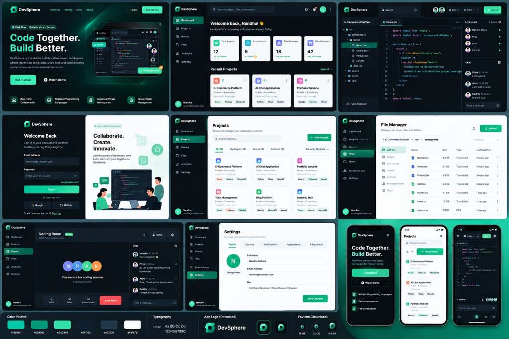
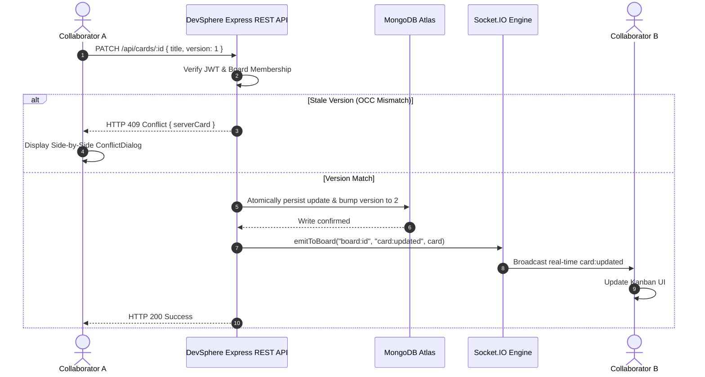

# DevSphere — Real-Time Collaborative Project Workspace

> **Code Together. Collaborate Smarter. Build Better.**  
> A high-concurrency developer workspace engineered with the MERN stack, Socket.IO real-time bi-directional events, $O(1)$ fractional positioning, Monaco-style coding rooms, Cloudinary CDN asset storage, and Optimistic Concurrency Control (OCC).

---

### 👨‍💻 Author & Engineering Leadership

- **Author:** **Nandhakishore A**
- **Email:** [nandhakishore252@gmail.com](mailto:nandhakishore252@gmail.com)
- **GitHub Profile:** [@Nandhakishore-A](https://github.com/Nandhakishore-A)
- **Repository:** [https://github.com/Nandhakishore-A/DevSphere](https://github.com/Nandhakishore-A/DevSphere)

---

## 🎨 Complete UI/UX Workspace Design System



*DevSphere unified developer workspace: Dark emerald design system, real-time coding rooms, live chat, Kanban sprint boards, and cloud file management.*

---

## 🚀 Key Platform Capabilities

1. **Live Collaborative Coding Rooms:**
   - Multi-tab file explorer tree supporting TypeScript, React, Python, and CSS.
   - Real-time syntax-highlighted editor with line numbers and instant save capabilities.
   - Live collaborator roster with active status dots, voice/video/screen share controls, and synchronized workspace chat.

2. **Real-Time Kanban Sprint Workspace ($O(1)$ Reordering):**
   - High-concurrency sprint boards featuring dynamic multi-column workflows (`Backlog`, `To Do`, `In Progress`, `In Review`).
   - Powered by `@dnd-kit` drag-and-drop and sub-50ms Socket.IO real-time room broadcasts (`board:<id>`).
   - Fractional indexing ($O(1)$ positioning): Calculates midpoints between neighboring items (`(before + after) / 2`), requiring exactly 1 document write with zero sibling re-indexing.

3. **Optimistic Concurrency Control (OCC):**
   - Task cards track a monotonic integer `version`.
   - Concurrent edits trigger an `HTTP 409 Conflict` response with side-by-side visual diff comparison, allowing collaborators to choose *"Keep Collaborator's Version"* or *"Overwrite With Mine"*.

4. **Multi-Project Directory & Dashboard:**
   - Comprehensive workspace dashboard displaying active projects, live room counts, team members, and uploaded asset KPIs.
   - Filterable projects directory with tabs for *All*, *My Projects*, *Shared*, and *Archived*, tagged with technology stack chips (*React, Node.js, MongoDB, Tailwind*).

5. **Cloud File Manager & Cloudinary Integration:**
   - Dedicated cloud file manager with breadcrumb navigation and categorized views (*All Files, Images, Documents, Archives*).
   - Direct integration with Cloudinary CDN storage under `mern_stack_project_storage/DevSphere`.


6. **Three-Tier Role-Based Access Control (RBAC):**
   - **Owner:** Full workspace administration, member invitations, role management, and board deletion.
   - **Member:** Create, edit, reorder, and delete task cards and lists.
   - **Viewer (Read-Only):** Observes board state, searches/filters, and receives live WebSocket broadcasts without mutation permissions.

7. **Append-Only Activity Stream:**
   - Cursor-paginated timeline tracking who created, edited, moved, or deleted boards, lists, and cards.

---

## 💻 Technology Stack

| Layer | Technologies |
| :--- | :--- |
| **Frontend** | React 18, Vite 5, Tailwind CSS, `@dnd-kit` (Core & Sortable), Socket.IO Client, Axios, React Router 6, Lucide React Icons |
| **Backend** | Node.js (ES Modules), Express 4, Socket.IO 4, Mongoose 8, Zod, Helmet, Cookie-Parser, CORS, Express-Rate-Limit, BCryptJS, JSONWebToken |
| **Database** | MongoDB Atlas (High-Availability Cloud Cluster) |
| **Cloud Storage** | Cloudinary CDN (`mern_stack_project_storage/DevSphere`) |
| **Design System** | Emerald / Neon Teal (`#10B981`, `#059669`, `#047857`), Slate (`#0B131E`, `#0F172A`, `#1E293B`), Inter Typography |
| **Deployment** | Vercel Serverless Functions & Render Blueprint |

---

## 📐 Real-Time OCC Sequence Diagram



---

## 📁 Repository Directory Structure

```text
DevSphere/
├── client/                     # Vite + React 18 Single-Page Application
│   ├── src/
│   │   ├── api/client.js       # Axios client with interceptors
│   │   ├── components/
│   │   │   ├── Sidebar.jsx            # Left navigation sidebar
│   │   │   ├── Header.jsx             # Top search & quick actions bar
│   │   │   ├── Navbar.jsx             # Board navigation bar
│   │   │   ├── ListColumn.jsx         # Kanban column container
│   │   │   ├── SortableCard.jsx       # Draggable task card with OCC badge
│   │   │   ├── CardModal.jsx          # Task inspection & editing modal
│   │   │   ├── ConflictDialog.jsx     # Side-by-side OCC conflict resolver
│   │   │   ├── MemberModal.jsx        # RBAC role management modal
│   │   │   ├── CreateBoardModal.jsx   # Project workspace creation modal
│   │   │   └── ActivityPanel.jsx      # Audit history stream
│   │   ├── pages/
│   │   │   ├── Landing.jsx            # Public landing page with hero & preview
│   │   │   ├── Dashboard.jsx          # Workspace dashboard with 4 metric cards
│   │   │   ├── Projects.jsx           # Projects directory with filter tabs
│   │   │   ├── CodingRoom.jsx         # Live coding studio & workspace chat
│   │   │   ├── FileManager.jsx        # Cloud asset manager with Cloudinary
│   │   │   ├── Settings.jsx           # Profile, photo upload, and account
│   │   │   ├── BoardView.jsx          # Real-time collaborative Kanban board
│   │   │   ├── Login.jsx              # Split-screen authentication
│   │   │   └── Register.jsx           # Account creation with password checklist
│   │   ├── context/AuthContext.jsx    # Session state & JWT management
│   │   ├── theme.js                   # Emerald design palette constants
│   │   ├── socket.js                  # Socket.IO client singleton
│   │   └── App.jsx                    # React Router 6 configuration
│   ├── index.html                     # HTML5 entrypoint with Inter font
│   └── vite.config.js
│
├── server/                     # Node.js + Express + Socket.IO Backend
│   ├── api/index.js            # Vercel serverless entrypoint
│   ├── src/
│   │   ├── config/
│   │   │   ├── db.js                  # MongoDB Atlas connection gateway
│   │   │   ├── env.js                 # Environment validation
│   │   │   └── cloudinary.js          # Cloudinary v2 SDK configuration
│   │   ├── controllers/
│   │   │   ├── authController.js      # Register, login, profile, photo upload
│   │   │   ├── boardController.js     # Workspace CRUD & RBAC members
│   │   │   ├── cardController.js      # Task card mutations & OCC bump
│   │   │   └── listController.js      # Column management & reordering
│   │   ├── models/                    # Mongoose schemas (User, Board, List, Card, Activity)
│   │   ├── routes/                    # Express REST endpoints
│   │   ├── sockets/index.js           # Socket.IO room subscriptions
│   │   ├── app.js                     # Express app factory (CORS, Helmet)
│   │   └── index.js                   # HTTP server bootstrap
│   └── package.json
│
├── docs/screenshots/           # UI system & storage verification screenshots
├── package.json                # Monorepo workspaces definition
└── render.yaml                 # Infrastructure as Code blueprint
```

---

## 🛠️ Installation & Execution

### Prerequisites
- **Node.js** (v18.0.0 or higher)
- **npm** (v9.0.0 or higher)
- **MongoDB Atlas** cluster URI
- **Cloudinary** account credentials

### 1. Clone the Repository
```bash
git clone https://github.com/Nandhakishore-A/DevSphere.git
cd DevSphere
```

### 2. Install Dependencies
```bash
npm install --ignore-scripts
```

### 3. Configure Environment Variables
Copy `.env.example` to `server/.env`:
```bash
cp .env.example server/.env
```
Fill in your MongoDB Atlas and Cloudinary credentials:
```env
PORT=5000
NODE_ENV=development
CLIENT_ORIGIN=http://localhost:5173
MONGO_URI=mongodb+srv://<db_user>:<db_password>@cluster0.henwuyf.mongodb.net/DevSphere?retryWrites=true&w=majority
JWT_SECRET=devsphere_super_secure_jwt_secret_token_key_2026_at_least_32_chars
JWT_EXPIRES_IN=7d
CLOUDINARY_CLOUD_NAME=zsfupefr
CLOUDINARY_API_KEY=956281599364653
CLOUDINARY_API_SECRET=your_cloudinary_api_secret_here
CLOUDINARY_FOLDER=mern_stack_project_storage/DevSphere
```

### 4. Run Development Servers
```bash
# Run backend and frontend concurrently
npm run dev

# Or run separately:
npm run dev:server   # Express API on http://localhost:5000
npm run dev:client   # Vite Frontend on http://localhost:5173
```

---

## 🚢 Production Deployment

### Vercel Deployment
1. Connect your repository [`https://github.com/Nandhakishore-A/DevSphere`](https://github.com/Nandhakishore-A/DevSphere) to Vercel.
2. Set Root Directory to `client` for the frontend and `server` for the backend.
3. Configure the environment variables in the Vercel dashboard matching your `.env`.

---

## 📄 License
This project is licensed under the MIT License — authored by **Nandhakishore A**.
